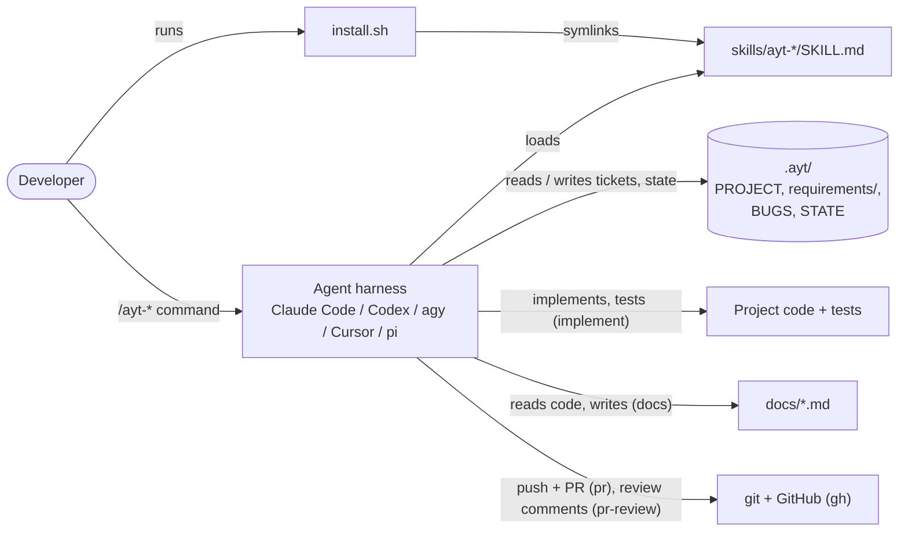
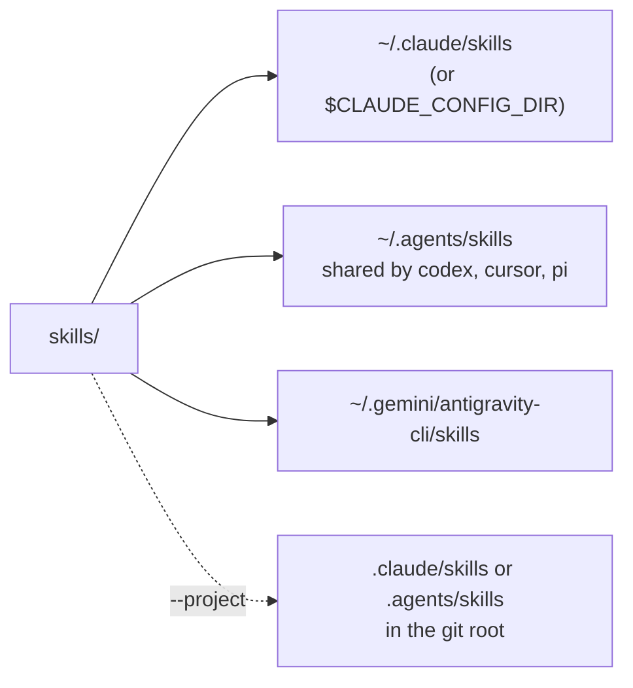

<!-- generated by /ayt-docs on 2026-10-29. Edit freely; re-run to refresh. -->
# Architecture

ayt has no runtime of its own. Its "code" is nine Markdown skills that an agent harness loads and follows, plus an install script. The skills coordinate only through plain-text files in `.ayt/`, which is why they work across harnesses.

## Components

| Component | Responsibility | Where |
|---|---|---|
| `ayt-init` | Scouts the repo, writes `PROJECT.md`, empty epic files, `STATE.md` | `skills/ayt-init/` |
| `ayt-new-idea` | Dedupes an idea against tickets, asks problem questions, then grills open design decisions until none are left, writes approved tickets | `skills/ayt-new-idea/` |
| `ayt-bug` | Dedupes, reproduces, links a bug to the ticket it breaks; doesn't fix | `skills/ayt-bug/` |
| `ayt-implement` | Test-first, one ticket at a time, resumable via `STATE.md` progress; edits code (`ayt-dyb` follows its steps too) | `skills/ayt-implement/` |
| `ayt-review` | Local review, no PR needed: done tickets vs code with fresh evidence + security pass; C1/M1 findings, ticks/unticks, may revert to `ready` | `skills/ayt-review/` |
| `ayt-dyb` | Wraps implement + review: up to N review passes (default 2) fixing criticals, then, after one yes, commits, runs `ayt-pr` and posts a fixed / open summary comment | `skills/ayt-dyb/` |
| `ayt-pr` | Stops on a dirty tree, cheap preflight, pushes and opens a PR from ticket evidence | `skills/ayt-pr/` |
| `ayt-pr-review` | Reviews an open PR against its tickets + security / constraints; posts critical / minor inline comments after you approve | `skills/ayt-pr-review/` |
| `ayt-docs` | Writes these user-facing `docs/` from the current code | `skills/ayt-docs/` |
| `install.sh` | Symlinks every skill into each named harness's skills dir | `install.sh` |

## Where skills install

## Key decisions and constraints

- **Text is the contract.** Skills share state only via `.ayt/*.md`; any harness that can read and write Markdown can run the loop.
- **Token-cheap.** Skills grep ticket todo lines (`^- \[`) and read only the relevant tickets; no subagents (except `ayt-dyb`'s optional fresh-context review pass), no workflow files loaded at runtime.
- **One source, many harnesses.** Skills are symlinked as-is; Claude-only frontmatter is kept and ignored elsewhere. Questions use a structured-question tool when present, otherwise plain text.
- **The user commits.** Only `ayt-dyb` commits, after one explicit yes that showed the message, files and PR comment; only `ayt-pr` pushes, and `ayt-pr-review` posts a review only after you approve the draft. `ayt-implement` and `ayt-dyb` edit code, `ayt-docs` edits only `docs/` files it generated, everything else writes only `.ayt/`.
- **Ticket ids are Jira-style** (`<PREFIX>-<N>`, epics and their prefixes in `PROJECT.md`) so parallel branches rarely clash; `ayt-pr` catches the ones that do.
