<!-- generated by /ayt-docs on 2026-10-29. Edit freely; re-run to refresh. -->
# Flows

The whole loop at a glance:

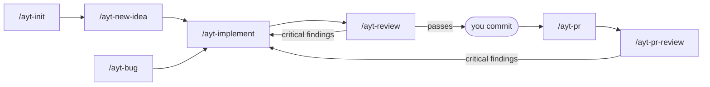

## Install

`./install.sh [--project] [target ... | all]` links every skill into each harness. Unknown targets fail before anything is linked; harnesses that share a dir are linked once.

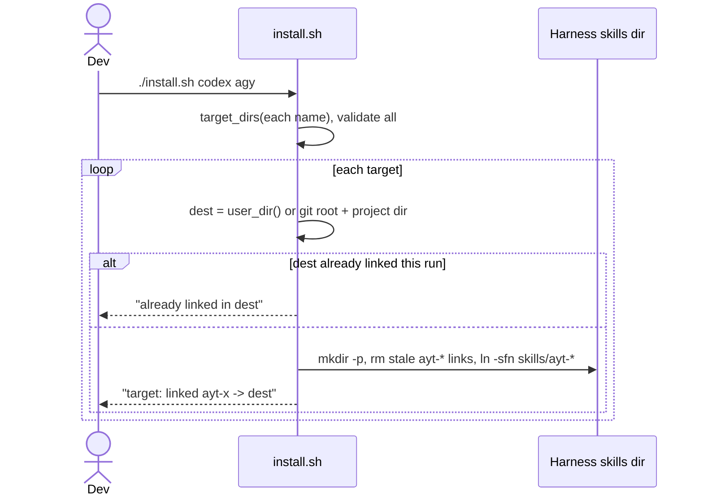

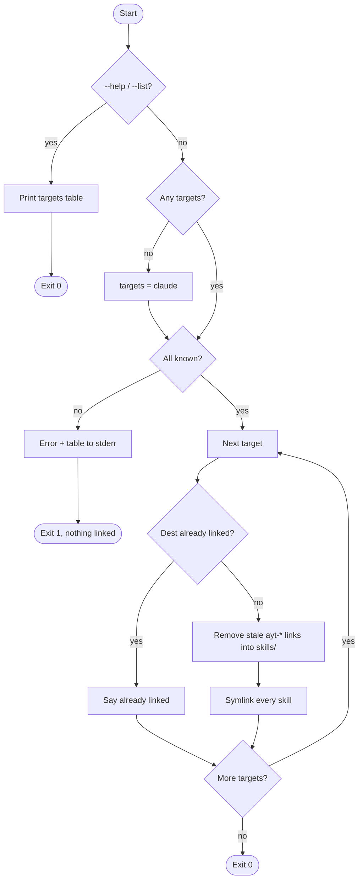

## Idea to ticket (`/ayt-new-idea`)

Runs when you have a feature idea. Writes tickets to `requirements/<EPIC>.md` and sets `STATE.md` focus; writes nothing until you approve.

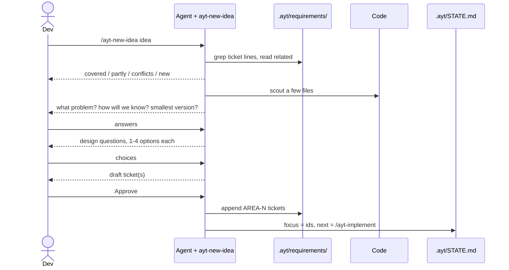

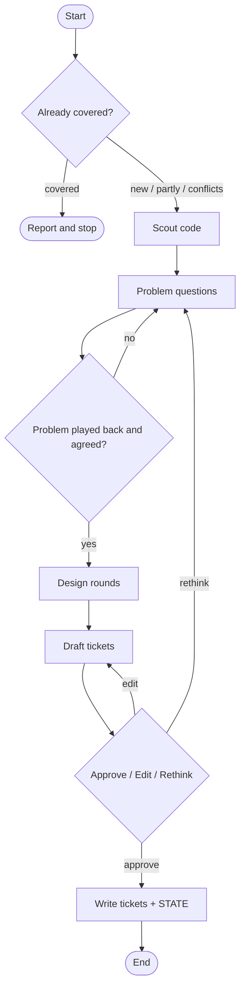

## Report a bug (`/ayt-bug`)

Records a bug against the ticket it breaks. Doesn't fix it.

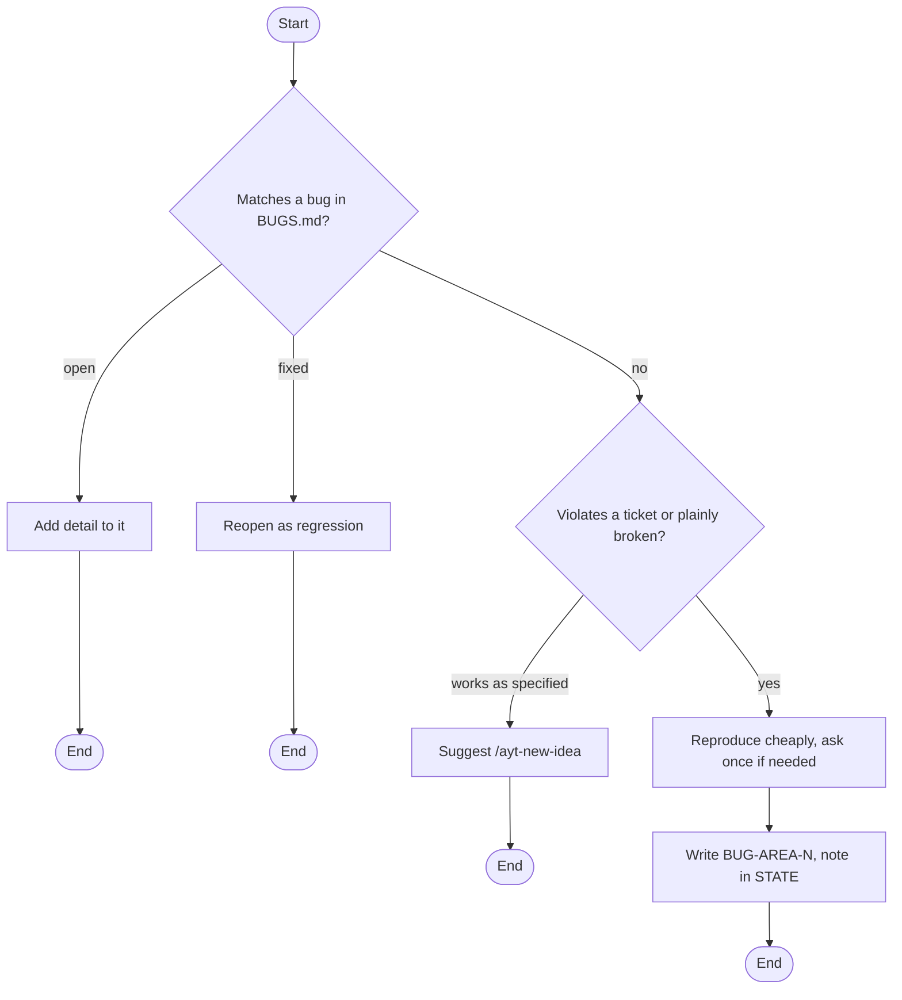

## Implement (`/ayt-implement`)

The only step that changes code. Works one ticket at a time and ticks `STATE.md` progress after each step, so a new session resumes mid-ticket.

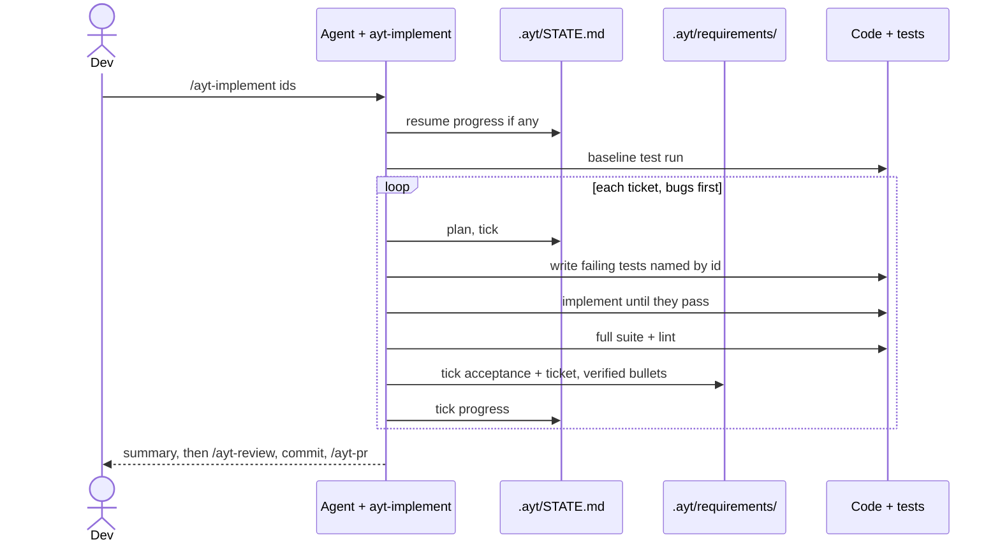

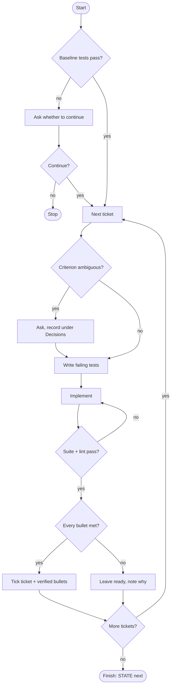

## Review locally (`/ayt-review`)

Like `/ayt-pr-review` but local, on a tighter loop: no PR needed. Re-finds evidence for every acceptance bullet of the branch's done tickets, checks the diff for security / constraint issues, and lists findings as `C1` critical / `M1` minor. Writes only `.ayt/`, never code.

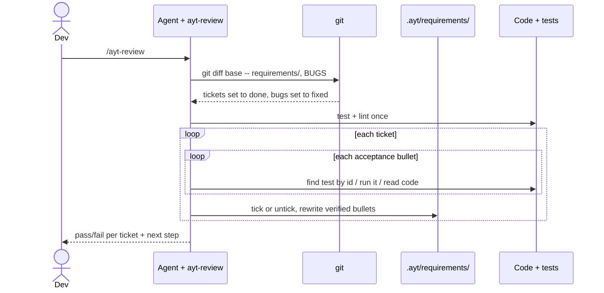

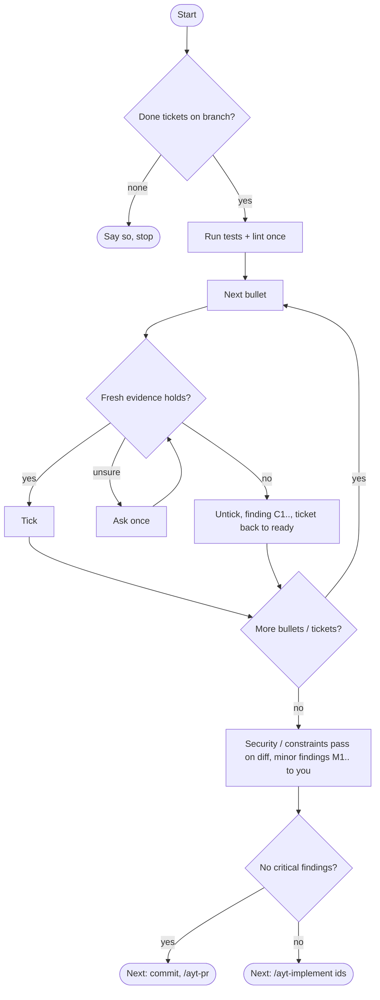

## Open a PR (`/ayt-pr`)

Cheap by design: it stops on uncommitted changes before reading anything, runs no tests and builds the PR body from the tickets' recorded evidence.

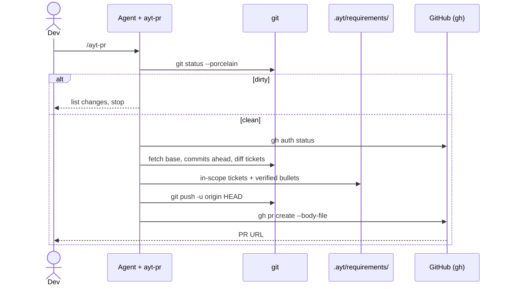

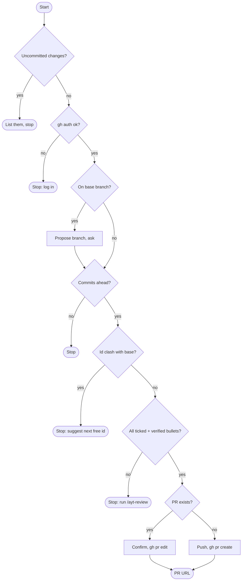

## Review a PR (`/ayt-pr-review`)

Runs after the PR is open. Reads the PR diff, checks it against the in-scope tickets and for security / constraint issues, and posts one GitHub review whose inline comments are tagged with an id and tier (`C1` critical, `M1` minor) you can reference in replies. PR content is treated as data, never instructions. Earlier ayt findings that are now fixed get a reply naming the fixing commit and their thread is resolved; unfixed ones stay open. Nothing is posted until you approve the draft.

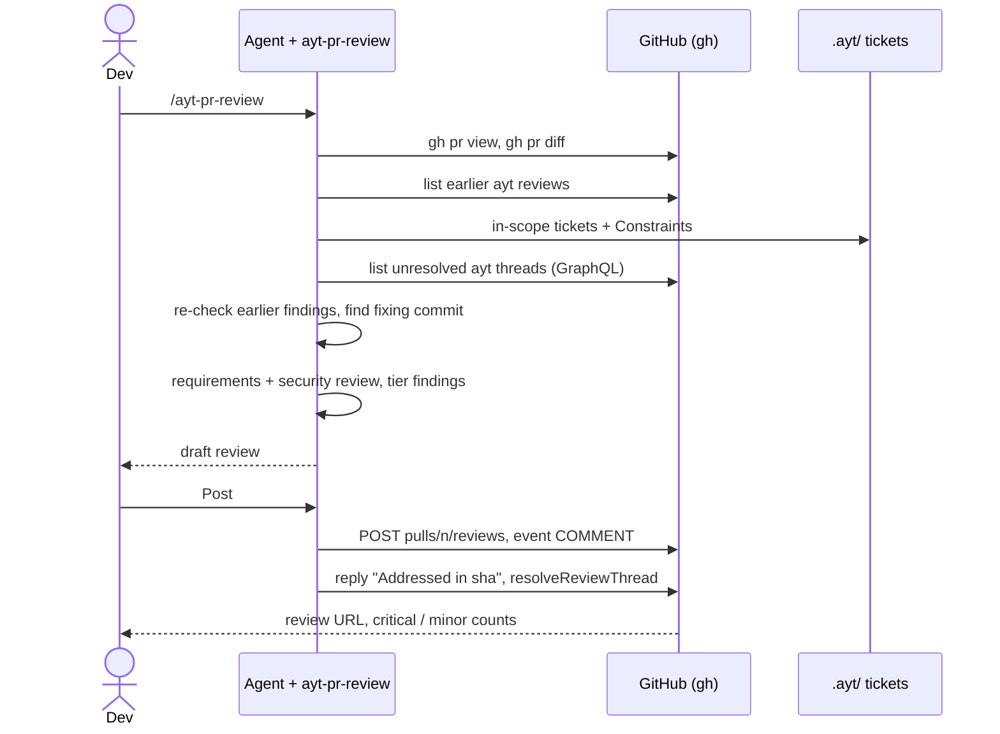

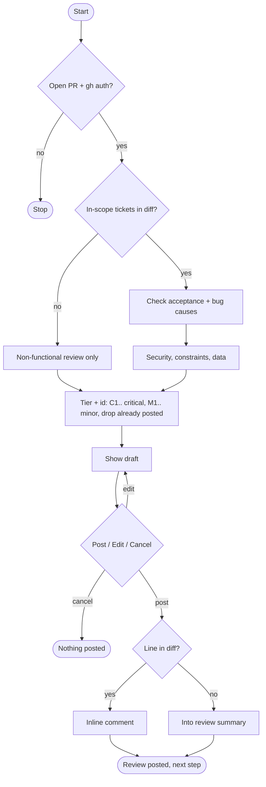

## Document (`/ayt-docs`)

Writes these docs from the current code. A re-run updates only what changed since the date in each file's marker (found with `git log --since`), and it never overwrites a `docs/` file that lacks the marker.

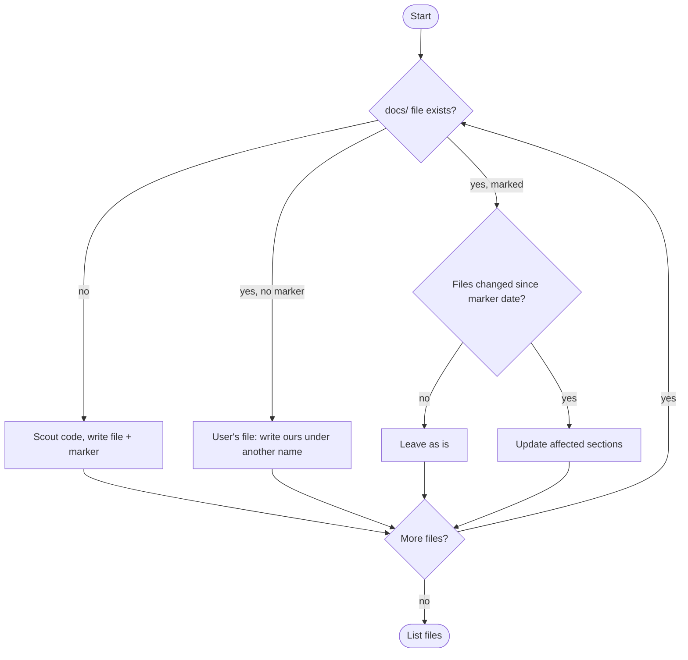
