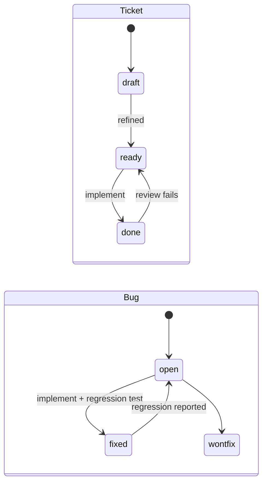

<!-- generated by /ayt-docs on 2026-10-29. Edit freely; re-run to refresh. -->
# Status

## What works today

**Planning**
- Set up ayt in a repo or a monorepo subproject, with stack, commands and epics inferred [PLAN-1]
- Turn an idea into approved, testable tickets, checked against existing ones first [PLAN-2]
- Record bugs against the ticket they break, with dedupe and regression reopening [PLAN-3]
- Skills work in any harness: structured questions where supported, plain text otherwise [PLAN-4]
- Tickets as one todo list per epic (`requirements/<EPIC>.md`); existing planning docs (e.g. GSD) can be imported keeping their ids [PLAN-5]

**Building**
- Test-first, resumable implementation of tickets and bug fixes; never commits [IMPL-1]
- Local review (`/ayt-review`, no PR needed) of a branch's tickets against code with fresh evidence, findings tiered C1 / M1 [SHIP-3, SHIP-6]
- Review includes a security / constraints pass on the diff; findings it can't settle are flagged to you [SHIP-4]
- `/ayt-dyb [N]` implements, then loops review and fixes (default 2 passes, fresh-context reviewer when the harness has subagents); after one yes it commits, opens the PR and posts a fixed / open summary [SHIP-8, SHIP-9]

**Shipping**
- PRs that map each ticket to its evidence; stop early on a dirty tree, no re-testing [SHIP-2]
- PR reviews posted to GitHub: inline comments tiered critical / minor, checked against tickets and for security issues [SHIP-5]

**Install**
- One install script for Claude Code, Codex, Antigravity, Cursor and pi, user or project scope, with `--list`; re-running cleans up links from renamed skills and relinks after the clone moves; never overwrites your own files [INST-1, INST-2, INST-3, INST-4, INST-6]
- `uninstall.sh` removes only the links it made [INST-7]
- MIT licensed, with a clone-and-install quick start in the README [INST-5]

**Docs**
- These docs: overview, architecture, flows with sequence and activity diagrams, status [DOCS-1]

## Next up

- PR review closes addressed findings: fixed earlier findings get a reply citing the commit and their thread is resolved; built, one review fix left [SHIP-7]

## Known issues

Open bugs (none high):
- medium: `/ayt-pr-review` may miss earlier ayt reviews on PRs with more than 30 reviews or comments, and re-post or reuse ids [BUG-SHIP-2]
- medium: `/ayt-pr-review` builds GraphQL queries with GitHub-fetched values in the query text instead of variables [BUG-SHIP-3]
- low: from a monorepo root, some skills don't find a project's `.ayt/` below them; run them from the project dir [BUG-PLAN-1]
- low: `/ayt-review` and `/ayt-implement` run the `test:` / `lint:` commands in `.ayt/PROJECT.md`; on someone else's branch, check those first [BUG-SHIP-4]

Harness quirks (draft INST-8):
- Codex and Antigravity may run skills automatically, because they ignore `disable-model-invocation`.
- Cursor also reads `~/.claude/skills`, so after `install.sh all` each skill may appear twice there.
- Not yet dogfooded inside a non-Claude harness.

## Lifecycles

